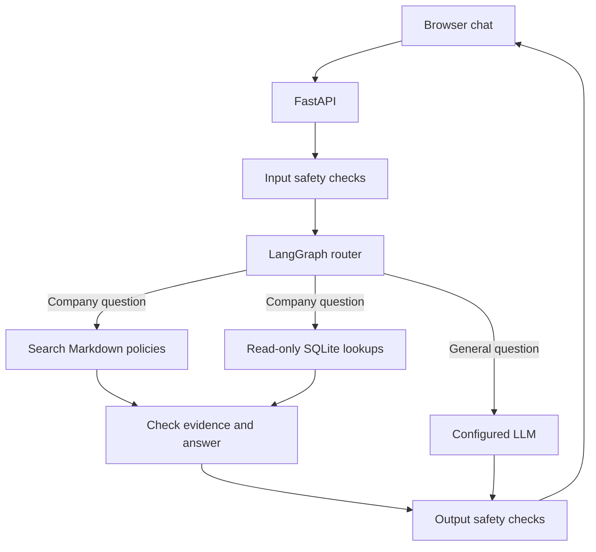

# Enterprise Agentic AI OS

A beginner's guide to the complete local demo. This project is a small company
operations assistant that can answer general questions, look up sample company
policies, and read mock tickets or employees. It runs on your computer and does not
make changes to ticket or employee records.

## What you can do with it

- Open a chat-style browser interface at `http://127.0.0.1:8000`.
- Ask whether sample ticket `102` fits the local refund policy.
- See the policy sections and ticket record used to prepare the answer.
- Ask for a sample employee or ticket by its ID.
- Try prompt-injection and write-action examples and see the safety checks reject them.
- Check whether the database, assistant, model settings, and policy files are ready.
- See aggregate request counts and response time while the server is running.

The included information is demonstration data. This is a single-user, unauthenticated
portfolio project, not a production company system.

## How the pieces work together

Think of FastAPI as the front desk: it receives browser requests and sends each one to
the correct part of the application. LangGraph coordinates the assistant's steps.



1. The browser sends a question to `POST /api/v1/ask`.
2. Input checks reject common instruction-override requests, requests for certain
   sensitive information, and requests to change company records.
3. The LangGraph router asks the configured model whether the question is general or
   needs company information.
4. Company questions search the local Markdown policies and, when a ticket or employee
   ID is stated, run a fixed SQLite `SELECT` query.
5. The assistant answers from available evidence. If a needed policy or record is
   missing, it returns `needs_sources` instead of guessing.
6. Output checks reject answers that look like they contain certain secrets or that
   answer a company-specific question without source references.
7. FastAPI returns the answer and source references to the browser.

The model does not write SQL. The record tools accept specific IDs and use fixed,
parameterized queries through a SQLite read-only connection.

## Project layout

```text
frontend/index.html                       Browser chat and live status panel
data/policies/*.md                        Sample policy documents used by local retrieval
data/seed/*.json                          Mock employees and tickets used by database setup
scripts/verify_readonly.py                Manual check that application DB connections reject writes
backend/src/enterprise_os/main.py         FastAPI application and GET /
backend/src/enterprise_os/config.py       Settings loaded from the root .env file
backend/src/enterprise_os/api/            Request/response schemas and HTTP routes
backend/src/enterprise_os/db/             SQLite schema, setup, connections, and queries
backend/src/enterprise_os/graph/          LangGraph state and assistant workflow
backend/src/enterprise_os/llm/            OpenAI/Gemini provider configuration
backend/src/enterprise_os/rag/            Local Markdown policy search
backend/src/enterprise_os/tools/          Fixed read-only company record lookups
backend/src/enterprise_os/safety/         Input, evidence, and output guardrails
backend/src/enterprise_os/observability/  Local request metrics and privacy-preserving logs
.env.example                              Names and defaults for supported settings
.local/company_ops.sqlite                 Generated SQLite database (created during setup)
```

## What the important words mean

- **API:** a set of URLs that another program, such as the browser page, can call.
- **FastAPI:** the Python web framework serving the API and browser page.
- **LLM:** a language model. You configure either OpenAI or Gemini as the provider.
- **LangGraph:** the workflow coordinator that routes a question and moves between steps.
- **RAG:** retrieval-augmented generation. The assistant finds relevant local policy text
  and gives it to the model as evidence for an answer.
- **Tool:** a limited Python function the workflow can use. This project has fixed,
  read-only ticket and employee lookups.
- **Guardrail:** a check that blocks certain unsafe inputs, retrieved instructions, or
  generated outputs.
- **SQLite:** a small database stored as a local file, rather than a separate server.
- **Checkpoint:** saved workflow state used by LangGraph. Checkpoints are stored in the
  SQLite file, separately from changes to employee or ticket records.

## Requirements

- Windows, macOS, or Linux
- Python 3.12
- [`uv`](https://docs.astral.sh/uv/) for installing dependencies and running the project
- An API key for the provider you select, and access to that provider from your machine
- Internet access for the model API and the Tailwind browser CDN used by the web page

No Node.js, npm, React, or Vite is used.

## First-time setup

Run these commands from the **repository root**: the folder containing this `README.md`.
The `--project backend` option tells `uv` where the Python project lives.

```powershell
uv python install 3.12
if (-not (Test-Path .env)) { Copy-Item .env.example .env }
uv sync --project backend
```

Open the root `.env` file and configure one provider. Set `LLM_PROVIDER` to `openai` or
`gemini`, then fill the matching API key and model variables:

| Setting | Purpose |
| --- | --- |
| `LLM_PROVIDER` | Selects `openai` or `gemini`. |
| `OPENAI_API_KEY` | OpenAI key; used when `LLM_PROVIDER=openai`. |
| `OPENAI_MODEL` | OpenAI model name; used when `LLM_PROVIDER=openai`. |
| `GEMINI_API_KEY` | Gemini key; used when `LLM_PROVIDER=gemini`. |
| `GEMINI_MODEL` | Gemini model name; used when `LLM_PROVIDER=gemini`. |
| `LLM_TIMEOUT_SECONDS` | Maximum wait for a model call; defaults to 45 seconds and allows up to 120. |
| `DATABASE_PATH` | SQLite file path; defaults to `.local/company_ops.sqlite`. |
| `SQLITE_TIMEOUT_SECONDS` | SQLite wait limit; defaults to 5 seconds. |

The API keys are read as secret settings and are not shown by the readiness endpoint.
Do not put real keys in source code or commit `.env` to version control.

Create or refresh the local sample database:

```powershell
uv run --project backend python -m enterprise_os.db.bootstrap
```

This command is idempotent: it can be run again to restore the checked-in sample rows.
It is the setup command that writes the sample employee and ticket data. The API record
tools themselves open SQLite in read-only mode.

## Run the project

From the repository root, start the server:

```powershell
uv run --project backend python -m enterprise_os
```

Keep that terminal open. The server listens only on `127.0.0.1` (your own computer) at
port `8000`. Open the browser demo at:

**http://127.0.0.1:8000**

The interactive API page is at <http://127.0.0.1:8000/docs>. Stop the server with
`Ctrl+C` in its terminal. After changing Python code, restart the server to load it.

The browser page is one file: `frontend/index.html`. Its chat uses plain JavaScript;
Tailwind styles come from the CDN. The right-side panel polls the assistant readiness
and metrics endpoints. The CDN provides styles, not backend functionality.

## Try the three browser demos

The chat shows three sample buttons:

1. **Ticket lookup:** asks whether ticket `102` fits the refund policy. It should return
   an answer with expandable policy and ticket citations.
2. **Prompt injection:** asks the assistant to ignore its instructions and reveal its
   hidden prompt. The input guardrail should reject it with a red HTTP `400` badge.
3. **Write action:** asks the assistant to approve a refund. The read-only guardrail
   should reject it with a red HTTP `400` badge.

Ticket `102` was delivered on October 10, 2026, and its refund request was made on
November 15, 2026: 36 days later. The sample refund policy has a 30-calendar-day return
window. The ticket requests the original payment method and says the item is unopened.
The ticket does not record a supervisor-approved exception, so an answer must not claim
that an exception was approved.

To try a missing-record case, ask: “Does ticket #9999 violate our refund policy?” The
assistant should return `needs_sources` because that ticket is not in the sample database.

## Endpoints

| Method and path | What it does |
| --- | --- |
| `GET /` | Serves the browser demo. |
| `GET /health/live` | Confirms that the web server process is running. |
| `GET /health/ready` | Checks that the SQLite schema is initialized and readable. |
| `GET /health/assistant` | Checks database, graph, selected provider settings, and policy file count. It does not call the model. |
| `GET /health/metrics` | Returns process-local request counts and average duration. |
| `GET /api/v1/tickets/{ticket_id}` | Reads one sample ticket by ID. |
| `GET /api/v1/employees/{employee_id}` | Reads one sample employee by ID. |
| `POST /api/v1/ask` | Routes a question and returns an answer, a source-needed response, or a handled error. |

`/health/assistant` returns `ready` when required local components and provider settings
are present. It checks that the key and model fields are configured; it does not prove
that a live provider request will succeed. `/health/metrics` is kept in memory and resets
when the server restarts.

For `POST /api/v1/ask`, the response includes:

- `request_id`: a unique ID for this request.
- `intent`: `general` or `company_data`.
- `status`: `answered` or `needs_sources`.
- `answer`: the text shown in the chat.
- `sources`: policy section and/or record references used for a company answer.

The browser expands `sources` so you can inspect references such as
`refund_policy.md#Return window` and `ticket:102`.

## How local policy retrieval works

Policy files are Markdown documents in `data/policies/`. The retriever splits them at
Markdown headings, compares normalized words in the question with each section, and
returns the most relevant matches. The answer model receives those sections along with
any requested record data. This is a lightweight lexical RAG demo: it does not use an
embedding model, vector database, or remote document service.

To add or edit a policy, create or edit a `.md` file in `data/policies/`. Use clear
Markdown headings so citations identify a useful section. The retriever reads those
files while handling company questions.

## How SQLite stays read-only for assistant lookups

The database schema is defined in `backend/src/enterprise_os/db/schema.sql`. Sample rows
are loaded from `data/seed/` by the bootstrap command. The API opens the database using
SQLite's read-only mode and uses fixed, parameterized `SELECT` statements. The assistant
does not accept arbitrary SQL and cannot update or delete employee or ticket records.

LangGraph does save its workflow checkpoints in the SQLite file. That is workflow state,
not a write to the sample employee or ticket tables. Treat the local database as private,
since checkpoint state can contain request and retrieved-evidence data.

To verify SQLite rejects writes through the application's read-only connection, run
this command from the repository root:

```powershell
uv run --project backend python scripts/verify_readonly.py
```

## Safety, logs, and limits

- Input guardrails block common prompt overrides, certain sensitive-data requests, and
  direct requests to change company records. These appear as HTTP `400` responses.
- Retrieved policy or record text is checked for common instruction-override patterns
  before it is given to the model.
- Output checks reject some secret-shaped values and company answers without source
  references.
- These are simple pattern-based demo guardrails, not complete security or content
  moderation. Do not use real confidential company or personal data with this project.
- Request logs contain a request ID, outcome, intent, source count, and duration. They
  do not include the question or answer text. Metrics are aggregate and process-local.
- The app has no user login, API authentication, multi-user handling, organization
  separation, human approval loop, or write-action tools. Keep it on localhost.

## Common problems

**The browser shows “API unavailable.”** Start the FastAPI server and open
`http://127.0.0.1:8000` while it is running.

**`/health/assistant` reports degraded or HTTP `503`.** Check that the SQLite database
has been bootstrapped, the selected provider key and model are set in the root `.env`,
and at least one `.md` file is present in `data/policies/`.

**A question returns HTTP `400`.** This is expected for the prompt-injection and write-
action demo prompts. Try the ticket lookup prompt for a normal request.

**A question returns `needs_sources`.** The assistant could not find a requested record
or a relevant policy section. Check the ID, sample seed data, and policy Markdown.

**A request times out.** Check your provider settings and internet access. The model
timeout is controlled by `LLM_TIMEOUT_SECONDS` in the root `.env` and is limited to
120 seconds by the current settings validation.

**`uv` says the `backend` project cannot be found.** Change to the folder containing
this `README.md` before running commands that use `--project backend`.

## Project scope

This is a local learning and portfolio demo. It shows how a small FastAPI application,
a LangGraph workflow, local RAG, restricted database tools, guardrails, and a browser UI
can work together. The sample data is fictional. It is not a live company deployment,
and the application should not be exposed publicly without adding authentication,
authorization, stronger security controls, and production operations work.
